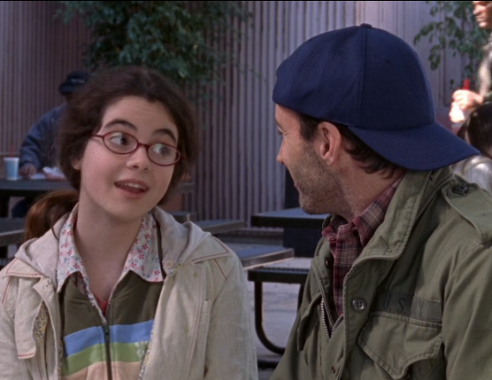

**I haven't posted any new content here for months** now but something happened that deserves a mention.  Stay with me, this does get relevant.

**The _Dungeon Crawler Carl_ series by Matt Dinniman is my jam.**  I read the first one a few months back, rated it 5 stars on StoryGraph and haven't looked back.  I have forced myself to read other, lesser books inbetween, in an attempt to slow the pace.  Every new book is like coming home.  It's equally funny, addictive and - crucially in the current creative crisis - new.  After the initial 'WTF is this' it's a guaranteed dopamine hit in every chapter.

In the first book, the protagonist - a normal guy called Carl, off-handedly names two unnamed side characters, Rory and Lorelai.  There's no setup, no reason, no explicit reference to Gilmore Girls in the whole of the rest of the book.  **If you didn't know, you wouldn't know.**  I'm assuming you get the reference.

The author does it again in a later book where a character refers to April  being an example of a blatant - albeit failed - attempt to keep a story from becoming stale.  I mean... yeah but harsh.

**For the longest time I couldn't figure who the book would appeal to.**  Even though I loved it, it's a hard recommendation because the obvious target demographic is tricky.  Gamers who read?  Humour for geeks?  Mainstream RPG folk?  Two months later, my whole family are devouring the whole series, including a librarian whose favourite book is _Anne of Green Gables_), a physics college student who was in a reading slump, and a monosyllabic 14-year old who only plays computer games.

But the reason this brought me out of hibernation is that **there's a deep cut in Book 8 that will honestly floor you.**  

It did me, last night.  

Again, the cultural reference passes by, almost nonchalantly.  Only Gilmore Girls superfans will realise what it is.  I had to put my book down for a second and just savour the moment.  It's amazing and unnecessary and absolutely worth your time.